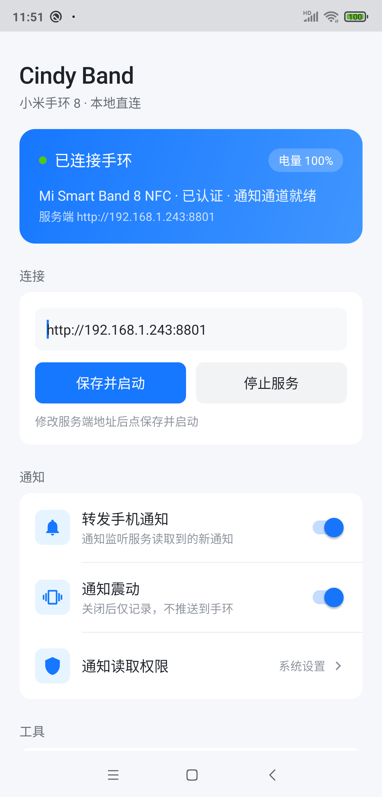
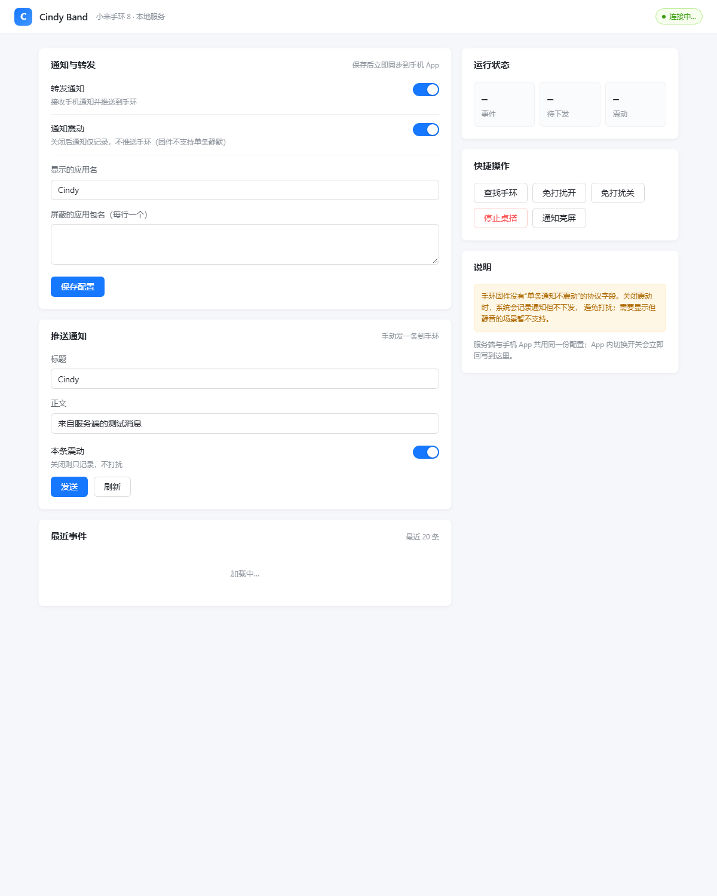

# Cindy Band

An open-source BLE client for the Xiaomi Smart Band 8 (NFC).
It ships a PC client, an Android app, a local server and MCP tools, without requiring the official app to stay connected.

> For research and personal use with devices you own. Not affiliated with Xiaomi.

## Features

- Two clients: Python + Bleak on PC, Kotlin + BouncyCastle on Android
- Full protocol stack: FE95 GATT, framing, HKDF session derivation, AES-CCM
- Local binding: derive encrypt_key via P-256 ECDH without a Xiaomi account (experimental)
- Notification relay: per-app filtering, optional vibration, deduplication
- Device features: battery, find band, DND, phone silent mode, music card, bedside clock
- Server: FastAPI + SQLite + Ant Design-style web console
- MCP: expose band capabilities as standard MCP tools for Claude / Cursor / Codex

## Architecture

    ┌─────────────────────────────┐
    │ Android App (Kotlin)        │  notification listener → band
    │  ├─ BandClient  protocol    │
    │  └─ BandService foreground  │
    └──────────────┬──────────────┘
                   │ BLE (FE95)
            ┌──────▼──────┐
            │  Mi Band 8  │
            └──────▲──────┘
                   │ BLE (FE95)
    ┌──────────────┴──────────────┐
    │ PC client (Python + Bleak)  │
    │  └─ band8/cli.py            │
    └──────────────┬──────────────┘
                   │ HTTP
    ┌──────────────▼──────────────┐
    │ Server (FastAPI + SQLite)   │
    │  └─ Web console / REST      │
    └──────────────┬──────────────┘
                   │ stdio
    ┌──────────────▼──────────────┐
    │ MCP Server (FastMCP)        │
    └─────────────────────────────┘

## Repository layout

    android/          Android app (protocol stack, foreground service, notification relay)
    band8/            PC client (protocol, keystore, CLI, local binding)
    server/           FastAPI server and single-page console
    mcp_server/       MCP tools and desk daemon
    docs/             Protocol analysis, connection chain, capabilities, UI design
    scripts/          Helper scripts (BLE scan, watchface capture)

## Quick start

### PC client

    python -m pip install bleak cryptography
    python -m band8.cli scan

After obtaining the band MAC and key:

    python -m band8.cli import AA:BB:CC:DD:EE:FF 0123456789abcdef0123456789abcdef
    python -m band8.cli info AA:BB:CC:DD:EE:FF
    python -m band8.cli notify AA:BB:CC:DD:EE:FF "Title" "Body"

### Where the key comes from

encrypt_key is a 16-byte long-term key derived during binding, not a fixed value.

- Unbound band: use the experimental local binding

      python -m band8.cli bind AA:BB:CC:DD:EE:FF

  Based on the official implementation: P-256 ECDH then
  HKDF(shared, appRandom||devRandom, "miwear-bind"), taking derived[40:56] as encrypt_key.
  Field ordering still needs validation on an unbound device.

- Bound band: unbind in the official app or factory reset first.
  A bound band cannot be taken over by a third party; this is by design.

### Android app

1. Open android/ in Android Studio;
2. Build and install;
3. Enter band MAC, device key and server URL on the home screen;
4. Grant Bluetooth and notification listener permissions.

### Server

    python -m pip install -r server/requirements.txt
    python server/app.py

Listens on 0.0.0.0:8801; open http://127.0.0.1:8801/ .

### MCP

    python -m pip install "mcp>=1.9"
    CINDY_BAND_SERVER=http://127.0.0.1:8801 python mcp_server/server.py

Register the stdio server in your MCP client.

## Verified capabilities

| Feature | Status | Notes |
|---------|--------|-------|
| Auth and encrypted channel | Verified | cmd26/27 + HKDF + AES-CCM |
| Battery | Verified | 2/1 |
| Notifications | Verified | 7/0, key field required |
| Find band | Verified | 2/18 |
| DND / phone silent | Verified | 2/23 / 2/44 |
| Music card | Verified | 18/1 |
| Bedside clock | Verified | 17/9 (official bedtime_clock) |
| Custom watchface | Research | needs package and signature |
| Local binding | Protocol recovered | pending unbound-device validation |

## Screenshots

Android app:

Web console:

## Security and privacy

- Device keys are stored locally (band8/keystore.json, git-ignored);
- The server collects no telemetry;
- Never commit encrypt_key, device MAC addresses or internal network details;
- See SECURITY.md.

## Disclaimer

Personal research project, provided as-is without warranty.

- Do not use it to take over devices you do not own;
- Do not use it to bypass paid content, accounts or device authorization;
- Protocol implementations may break with firmware or app updates;
- Use at your own risk.

## License

MIT (see LICENSE)
